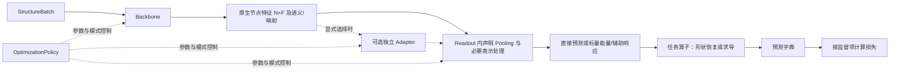

# 性质预测组件解耦需求

更新日期：2026-11-03。状态：实施中；A～D代码已就绪，完整回归与E真实链验收待完成。

本需求围绕标量、谱、力场和张量预测，以统一模型输出协议和可替换 readout 为第一版核心。
默认结构为 Backbone → 原生节点特征 [N,F] → Readout → 预测；adapter 仅作为有独立复用价值时显式选择的可选组件。
下文是实施与验收约定；通过项须以test记录和真实验收文件为依据，不能将接口已实现当作实验已通过。

## 1. 背景与目标

当前已有官方 backbone 和自定义 GNN 接入、统一节点表示、性质规格、直接/响应读出，以及能量求导力场。
主要限制见以下实现：

- [模型组装](../../src/universal_gnn/tasks/models.py)：标量路径默认使用宽度32的适配层，adapter/readout 的选择主要由内部规则决定。
- [特征适配](../../src/universal_gnn/adapters/features.py)：标量压缩与几何提升都可用，但缺少独立配置入口。
- [读出实现](../../src/universal_gnn/readouts/properties.py)：直接读出固定为逐节点 MLP 后聚合，响应读出采用专门的辅助变量求导。
- [训练器](../../src/universal_gnn/engine/training.py)：默认优化全部模型参数，尚无完整的组件级冻结策略。
- [续训与重建](../../src/universal_gnn/engine/runtime.py)：已有架构和任务兼容检查，新组合配置与参数组需要纳入其范围。

核心目标：在不修改 backbone 实现和官方图处理的前提下，让 readout 直接接收原生维度的节点特征，
用户可替换读出、聚合方式并控制主干/读出的训练状态。确有独立复用价值的特征转换再作为可选 adapter。
readout 的首层本身就是可学习维度映射，例如 F=256 时直接构造 Linear(256,128)，无需先压到32维，
也不需要为了匹配首层而额外 reshape 输入特征。

成功标准为：更换读出或冻结策略不要求修改 provider；更换具有兼容特征规格的 backbone 不要求重写任务头；
不兼容的组合在执行前给出明确原因；组合及训练状态能够严格重建和恢复。

## 2. 范围与优先级

### 2.1 本期必须完成

| 范围 | 必须支持的能力 |
| --- | --- |
| 模型输出协议 | 默认原生节点特征[N,F]及映射；自动读取F，自定义模型可声明feature_dim；首次前向校验 |
| Readout | 统一协议，linear、graph_mlp、node_mlp、现有 response 实现 |
| 特征处理 | 简单任务直接使用原生特征；张量等任务可在readout内部封装必要的表示处理；独立adapter为可选扩展 |
| Pooling | sum、mean、none；明确其位置和作用对象 |
| 训练策略 | backbone/readout分别冻结或训练；仅在显式存在独立adapter时增加该组件的训练控制 |
| 四类任务 | 标量、固定网格谱、能量求导力场、现有求导式张量路径 |
| 兼容与审计 | 旧配置/权重行为保留，新组合显式启用，组件参数与训练状态可追溯 |

### 2.2 本期边界

生成、MD/声子等模拟扩展、联合多任务训练、特征缓存、分层解冻、attention pooling、公开插件市场、
完整 benchmark 调度平台不属于本期验收条件。
直接等变张量头和新的响应构造方法保留扩展位置，本期不要求实现；现有响应读出应继续可用。
不新增空间群投影或额外晶体对称约束。
第一版不要求建设独立的 linear/MLP adapter 实现目录或统一特征压缩层。
现有特征转换可由对应 readout 内部复用；独立adapter注册与更多实现不构成原生特征直连路径的交付门槛。

本期需求不要求所有 backbone 支持全部任务。支持范围由特征与梯度能力决定，未支持组合必须显式拒绝。

## 3. 组件结构与职责



未配置 adapter 时，模型组装直接传递 NativeFeatures，不要求实例化独立 identity adapter。
Pooling 是独立可配置的操作，由 readout 按既定顺序调用；不应机械地固定在所有 readout 前面或后面。
已有目录继续承载职责，本期无需新增顶层包：

| 模块 | 职责与输入输出 | 建议实施位置 |
| --- | --- | --- |
| [contracts](../../src/universal_gnn/contracts/README.md) | 特征规格、读出要求及版本；保留样本/原子映射 | 在该目录新增特征/组件规格定义 |
| [backbones](../../src/universal_gnn/backbones/README.md) | 原生模型产生节点表示，声明可用特征和梯度能力 | 复用现有 provider；只增加必要元数据 |
| [adapters](../../src/universal_gnn/adapters/README.md) | 可选的可复用特征转换；不作为默认必经层 | 复用现有转换实现，按实际复用需要提供显式选择 |
| [readouts](../../src/universal_gnn/readouts/README.md) | 原生特征 → 指定 scope/shape 的张量；封装必要表示处理及聚合顺序 | 新增统一工厂、基础读出和输入维度检查，内部可复用已有转换模块 |
| [tasks](../../src/universal_gnn/tasks/README.md) | 组合组件与任务算子；保留能量求导和监督项语义 | 调整模型组装，不按 backbone 名称选择任务头 |
| [engine](../../src/universal_gnn/engine/README.md) | 配置解析、组件训练策略、优化器与 checkpoint | 新增训练策略辅助模块，扩展现有重建/续训检查 |

实施时各模块 README 必须同步输入输出、注册方式、使用示例与能力边界。

## 4. 接口与功能需求

以下 ID 用于实现和验收追踪；接口代码为示意，实际类名可在实施设计中调整，但职责不能合并回 backbone。

### 4.1 特征契约

- **CON-01**：统一模型输出协议，以原生节点特征[N,F]为数值主体，并保留kind、原子/样本映射、几何和可选graph_features。
  标量通道可由模型声明其不变标量语义，不要求用户额外手填irreps；协议包装可记录为Fx0e。
  非标量等变特征必须同时提供irreps、基底/约定及变换规则，不能只给F。provider还应声明已验证的
  坐标/应变输入梯度及混合参数梯度能力，供力场等求导任务匹配，不能仅凭模型名推断。
- **CON-02**：readout的输入维度优先由模型特征规格推导；不存在规格的自定义模型可显式声明feature_dim，
  具体规则见DIM-01～05。统一接口不要求所有模型采用相同F，也不要求独立投影后才能接入readout。
- **CON-03**：直连路径、可选adapter和readout内部特征处理必须保留原子顺序、batch/ptr、几何引用、dtype/device和梯度连接；
  graph_features 与来源元数据应保留，readout 未使用它们时应在组合说明中可见。
- **CON-04**：readout 必须声明输入类型要求、输出 scope/shape 与变换保证；工厂在组装时验证匹配。
  输入尺寸相同不足以认定表示语义兼容。不能在不兼容时静默选择另一条路线。

建议接口关系：

```python
feature_spec = resolve_feature_spec(backbone, declared_feature_dim)
readout = build_readout(readout_config, feature_spec, property_spec)
features = backbone.encode(batch)
validate_native_features(features, feature_spec)  # 首次前向核对[N,F]与映射
prediction = readout(features)
```

可选adapter仅在显式配置时插入；工厂据其输出规格构造readout，输入维度校验仍在backbone原生输出边界进行。

### 4.2 维度发现与首次前向检查

- **DIM-01**：优先从模型声明的特征规格读取feature_dim；若已有irreps，可据其总维度推导F。
  显式feature_dim与irreps维度同时存在时须一致。
- **DIM-02**：自定义模型允许在输出规格中声明feature_dim，也允许使用backbone.feature_dim作为配置回退，必须为正整数。
  若模型已提供F，配置值只作一致性断言：相同则接受，不同则在组装时拒绝，不能覆盖模型规格。
  两者都缺失时提示用户声明维度，不通过第一次优化后再补建readout或优化器参数组。
- **DIM-03**：backbone.feature_dim是输出协议声明，由UGNN组装层处理，不传作官方模型的隐藏层宽参数，
  不用于修改主干或权重形状。对已有规格的官方模型可省略该字段。
- **DIM-04**：首次实际前向必须在进入readout首层前核对rank=2、N等于输入原子总数、F等于解析值，
  以及映射、dtype/device和变换元数据的一致性。旋转变换保证由对应测试另行验证，不能只凭shape检查认定。
  错误报告声明来源、声明维度和实际shape；后续前向保持shape检查，防止可变输出宽度。
- **DIM-05**：维度F仅描述通道大小。偶标量特征可直接进入Linear(F,H)；向量/高阶通道需要readout理解irreps及基底，
  或在其内部显式构造合法不变量/等变表示。禁止仅凭F将等变通道当普通标量，禁止用额外reshape掩盖维度不匹配。
  张量输出的合法Cartesian/irreps转换及输出shape恢复不受此条限制。

### 4.3 可选Adapter与Readout内部特征处理

| ID | 类型 | 需求 |
| --- | --- | --- |
| ADP-01 | 省略/none | 默认不插入独立adapter，原生特征直接交给readout；无额外参数、压缩或reshape，不要求建立identity模块 |
| ADP-02 | 必要表示处理 | scalar不变量、equivariant几何提升/原生投影等可由对应readout内部封装，复用现有代码；处理方式、profile/cutoff/basis_version须显式记录；无必要时不执行 |
| ADP-03 | 可选独立复用 | 某转换需要被多个readout独立复用时可显式设置prediction.adapter；校验输入/输出规格并独立记录/训练。不得因为缺少独立adapter而拒绝合法的直连任务 |

readout内部处理是readout的一部分，其参数和冻结策略归readout；仅显式独立adapter才拥有独立训练开关与参数统计。
同一转换不能在两处被隐式重复执行。第一版的简单标量readout无需独立linear/MLP adapter工厂。
旧式配置继续使用原有构造规则，详见第7节。

### 4.4 Readout 与 Pooling

统一 forward 协议为 NativeFeatures → Tensor；任务包装层按现有预测字典格式命名输出。
直接读出与响应读出允许保留不同的梯度执行需求，统一工厂负责描述这种差异。

| ID | name | 定义与适用范围 |
| --- | --- | --- |
| RDO-01 | linear | 图级先pooling再Linear(F,D)；节点级直接Linear(F,D)且pooling=none。基础路径读取原生偶标量通道 |
| RDO-02 | graph_mlp | 图级先pooling再MLP，首层按原生F构造；适用于标量或固定长度谱，基础路径读取偶标量通道 |
| RDO-03 | node_mlp | 从Linear(F,H)开始逐节点MLP，再根据scope选择sum/mean/none；适用于逐原子输出与能量求和 |
| RDO-04 | response | 复用现有ResponseReadout；按显式feature_processing在readout内部处理必要表示，保留辅助量求导、参数梯度和变换保证 |
| RDO-05 | 注册接口 | 新 readout 可在 readouts 工厂登记，且无需修改官方 provider 或通用训练循环 |
| RDO-06 | 输出校验 | 保持现有预测形状约定：图级首维 B，节点级首维总原子数；shape、样本和原子映射不匹配时报错 |

- **POL-01**：支持 sum、mean、none。图级直接头要求 sum/mean；节点级直接输出要求 none；未知值拒绝。
- **POL-02**：graph_mlp 与 node_mlp 的聚合位置属于架构定义，解析配置和 checkpoint 必须保留。
  MLP(mean(h)) 与 mean(MLP(h)) 不得被当成等价配置。
- **POL-03**：聚合不能跨结构混合。一个结构单独预测与放入混合大小 batch 的预测应在约定容差内一致。
- **POL-04**：PropertySpec.reduction 与新式 readout.pooling 必须一致；存在冲突时拒绝，不能设置两个互相覆盖的来源。
  RDO-04 对 graph 响应沿用现有 mean 聚合，对 node 响应使用 none；本期不增加 response 的 sum 变体。

基础linear/MLP路径遇到非标量通道时必须有显式且合法的readout.feature_processing，或拒绝该组合；
scalar_invariants可在readout内部按声明规则生成不变量，再据其规格确定首层维度，不强制增加独立压缩层。
基础头不通过把任意等变分量当普通标量输入来扩大支持范围。
基础 readout.linear 的 bias 默认 true；graph_mlp/node_mlp 的 hidden_features 为必填非空正整数列表，
本期activation仅支持silu，省略时解析为silu；未知值拒绝。输出维度由PropertySpec推导，不能另设冲突的output_features。
readout.feature_processing省略时为none，不得自动附加32维ScalarAdapter；equivariant处理明确声明profile与版本。
无转换的基础路径首层使用原生F；显式采用内部处理或独立adapter时，首层使用其合法输出维度，
同时记录原生F和处理后维度，不能用人为声明的feature_dim替代实际转换。

### 4.5 四类性质的组合约束

| ID | 任务 | 本期必须保持的行为 |
| --- | --- | --- |
| TSK-01 | 标量 | 可选择 linear、graph_mlp、node_mlp；按性质的 mean/sum 语义聚合；输出单位和标签绑定保持现状 |
| TSK-02 | 固定网格谱 | 图级输出通道数与标签网格长度一致；支持上述直接头；本期沿用已有网格/预处理记录，不扩展动态网格预测 |
| TSK-03 | 力场 | 新式能量头固定为 node_mlp + sum，先预测原子标量能量再求和；由任务算子计算 F=-dE/dR 与应力，禁止无提示切换成独立力头 |
| TSK-04 | 张量 | 本期默认保留response构造；fixed-frame与equivariant路线由readout的显式表示处理及输入语义确定，必要时也可使用独立adapter；不能仅按backbone.kind静默改变保证 |
| TSK-05 | 监督 | 保留 task.supervised_outputs 的 E/F/S 非空子集语义，包括 force-only；adapter/readout 选择不能重新要求未选标签 |
| TSK-06 | 不支持组合 | 若梯度、表示、scope 或聚合不满足任务要求，应给出字段级错误和可行配置说明；不强制所有模型通过所有组合 |

TSK-03 的 sum 规定保证读出层的原子能量可加结构；整个模型的结构独立性与物理梯度还须结合原生 backbone 验证。
本期不增加无监督能量基线校准；force-only 仍不能确定能量常数或元素参考能量。

响应头的辅助变量求导是一种输出构造。除非额外定义并验证共同势函数，它不自动保证与另一个能量、
极化或应力预测头物理一致。本文档不引入此类新约束。

## 5. 组件训练策略

- **OPT-01**：基础训练开关为optimization.train_backbone、train_readout，类型为bool，默认true。
  仅组合实际包含独立adapter时才使用train_adapter，默认true；新式路径须显式选择，旧式路径原有adapter视为存在。
  无独立adapter时显式填写train_adapter应报错并提示删除。
  readout内部的表示处理由train_readout统一控制，不额外建立adapter参数组。
- **OPT-02**：仅将本次允许训练的参数加入优化器，组件参数归属不能重叠。全部参数组为空时应在训练前报错；
  纯推理允许所有组件冻结。
- **OPT-03**：冻结组件的参数不计算/积累梯度，其参数和持久 buffer 在训练中保持不变。
  冻结 backbone/adapter 默认保持 eval；训练器调用整个模型 train 后必须重新应用组件模式策略。
  被冻结的组件仍允许梯度穿过其计算，传向更早的可训练组件或几何输入。
- **OPT-04**：不能依据 train_backbone=false 直接用 no_grad 或 detach 包装 encode。
  力与应力监督必须保留坐标/应变导数，训练新能量头时仍需保留混合的输入/参数梯度。
  只有不需要输入导数且上游没有待训练参数时，才可采用经测试等价的无梯度执行优化。
- **OPT-05**：训练和推理记录每个组件的总参数、允许训练参数、冻结参数和模块模式；
  对 provider 中保留但不进入 encode/新任务路径的已知原始输出头单独标记，避免冒充有效新任务容量。
- **OPT-06**：同一网络结构从全参训练切换到头部训练属于训练策略变化，不修改 forward 的架构定义。
  完整续训必须校验策略和参数组，策略变更采用显式权重暖启动并重建优化器。

本期无需支持 backbone 内部的逐层选择与逐阶段解冻，也不要求新优化器或调度算法。

## 6. 配置要求与示例

本节均为未来配置模板。目录中的用户数据路径为占位路径，需由实施后的用户提供；不能用当前 CLI 宣称执行通过。
原有 dataset、task、device、dtype、batch_size、epochs 等字段继续使用既有语义。

### 6.1 新配置的启用与优先级

- **CFG-01**：通过顶层 prediction.version: 1 显式启用新组合方式；该版本独立于既有 schema_version 与 checkpoint 容器版本。
  prediction 未出现时保留旧式模型组装行为。
- **CFG-02**：新式配置的prediction.readout必填；adapter省略或显式name=none时不插入独立层，直接传递原生特征。
  optimization 可以独立应用于旧式网络，省略时保留全参训练默认行为，不触发架构迁移。
- **CFG-03**：新式prediction与旧task.route/task.adapter_version不能同时指定；默认张量路线的profile/basis_version写在
  readout.feature_processing内。仅当显式选择独立adapter时才写在adapter内，且必须避免重复转换。
  旧式配置原样解析。重复表达同一设置时给出错误，不能隐藏优先级。
- **CFG-04**：配置优先级沿用 CLI > 文件 > resume checkpoint > 默认值。
  当 CLI 更换任务时，必须重新校验已有 readout；旧任务的预测组件不得在不兼容时被静默清空或替换。
- **CFG-05**：prediction、adapter、readout、optimization 内未知字段、未知名称、非法维度/层宽、非bool训练开关、
  不合法pooling和不兼容组合必须在优化前报错。feature_dim来源冲突在组装时拒绝，实际输出不符在首次前向且首次优化前拒绝。
  readout.feature_processing同样进行字段校验，未知显式版本拒绝。
- **CFG-06**：新块本期仅用于 supervised/forcefield；generation 遇到 prediction 或 optimization 新块时显式提示该组合未支持。
  旧生成配置与权重继续按旧路径处理。

### 6.2 标量：保留原始表示，只训练图级读出

```yaml
schema_version: 1
backbone:
  name: alignn
dataset:
  path: data/user/bandgap.jsonl
task:
  kind: supervised
  property: bandgap
prediction:
  version: 1
  readout:
    name: graph_mlp
    pooling: mean
    hidden_features: [128, 64]
    activation: silu
optimization:
  train_backbone: false
  train_readout: true
dtype: float32
batch_size: 32
epochs: 100
```

此例没有独立adapter，实际仅训练readout；F从ALIGNN模型特征规格读取，若F=256，首层为Linear(256,128)。
改为全参微调只需将train_backbone改为true；
改变训练策略的既有实验应按 OPT-06 暖启动，不伪装完整恢复。

### 6.3 力场：冻结主干，仅使用力标签训练新能量头

```yaml
schema_version: 1
backbone:
  name: mace
dataset:
  path: data/user/forces.jsonl
  bindings:
    forces:
      key: forces
      unit: eV/angstrom
task:
  kind: forcefield
  supervised_outputs: [forces]
prediction:
  version: 1
  readout:
    name: node_mlp
    pooling: sum
    hidden_features: [64]
    activation: silu
optimization:
  train_backbone: false
  train_readout: true
dtype: float32
batch_size: 8
epochs: 100
```

数据须已有与配置一致的规范单位；unit 字符串不自动转换数值。
此配置仍通过坐标导数训练 readout，不要求 total_energy/stress 标签，不保证绝对能量或应力预测准确。
按需省略未请求的 E/F/S 计算属于后续独立优化，不作为本需求新增范围。

### 6.4 自定义模型维度和张量Readout配置片段

以下为两个独立片段，需分别合入完整配置。第一例插件目录是占位路径，模型须声明输出为不变标量，
实际返回[N,256]；若插件已有特征规格，feature_dim只作一致性断言。第二例task使用现有dielectric求导规格。

```yaml
backbone:
  name: plugin:/path/to/custom_model
  feature_dim: 256
prediction:
  version: 1
  readout:
    name: graph_mlp
    pooling: mean
    hidden_features: [128, 64]
    activation: silu
```

```yaml
prediction:
  version: 1
  readout:
    name: response
    pooling: mean
    feature_processing:
      name: equivariant
      profile: small_response
      basis_version: 2
```

张量示例采用同一显式 profile 的语义，不因更换兼容 backbone 自动切换为固定分量路线；
几何提升、所需 cutoff 和原生表示的适用性仍须校验并写入解析配置。
该处理封装在response readout内部，参数归readout，无须配置独立adapter或train_adapter。

## 7. 兼容、重建与续训

- **CMP-01**：没有 prediction 的历史配置和 checkpoint 保留原始32维适配、读出顺序、route、basis_version 和 state_dict 键语义。
  不能因新默认原生特征直连而改变历史模型的预测。
- **CMP-02**：新式模型保存完整解析配置、prediction 版本、组件规格/实现标识、pooling 位置、训练策略、参数组映射，
  以及原生F、维度声明来源、必要的irreps/基底、readout内部特征处理和可选独立adapter；
  保持现有官方artifact与源码签名检查。仅保存name或总参数量不足以重建。
- **CMP-03**：完整恢复要求组件名称、层宽、激活、profile、pooling、输出规格、冻结策略和参数组兼容；
  只增加总目标 epochs 的现有续训用法继续可用。
  纯推理按保存的组件架构重建并设为 eval；禁用参数梯度不能改变权重结构或被误判为头部变更，
  同时仍须保留力/应力等输出所需的输入导数。
- **CMP-04**：显式更换读出可采用 backbone 权重初始化或权重暖启动；不得把不同头的优化器状态直接套用。
  默认不允许全模型 strict=False 隐藏不匹配，必须记录加载/忽略/新初始化的组件与参数。
- **CMP-05**：既有 schema_version=1、checkpoint format1/2、training_state.version=1 不在本文中虚构升级。
  实施需评估新增结构和参数组记录是否要求版本提升，补充明确迁移说明与回放测试；发布前同步
  [格式标准](../standards.md)、[使用说明](../usage.md) 和各模块 README。
- **CMP-06**：旧格式 → 新格式的迁移必须显式记录，不通过反序列化时改变默认构造来完成。
  新需求不代表同维度的 adapter/readout 权重可在不同 backbone 之间直接交换。

## 8. 可审计输出

- **OBS-01**：config.resolved.json 必须写出全部生效默认值、输入/输出特征规格、选用读出及聚合位置；
  原生直连与旧32维压缩路径可以清楚区分；维度来源区分模型自动读取、自定义显式声明和二者一致性断言。
- **OBS-02**：报告分别列出backbone、readout及实际存在的独立adapter的参数与允许训练参数、冻结模式、聚合和输出语义。
  readout内部处理计入readout，不重复计入adapter；省略adapter时参数组中无该组件。
  已知未使用的原始头单列说明；不把模块注册参数数目直接当成有效任务参数量。
- **OBS-03**：错误应包含字段、实际规格、所需规格及原因，例如“readout.pooling=mean 不满足新式 forcefield 原子能量求和要求”。
  不能等到训练矩阵乘法报 shape 错才说明不兼容。
- **OBS-04**：训练损失、组件执行验收与测试集精度分别标注。本期执行测试不承担正式泛化性能或最优读出结论。

## 9. 验收与测试矩阵

实施前应在 [test 记录](../agents/test.md) 分单元登记具体用例和预期结果；计算任务遵守 Slurm 规则。
下列为本需求的验收要求，不表示本轮已执行这些测试。

| 验收ID | 覆盖需求 | 验收内容与预期结果 |
| --- | --- | --- |
| ACC-01 | CON-01～04、DIM-01～05、ADP-01 | 无adapter时原生[N,F]直连；测试自动F、自定义feature_dim、双声明相同/冲突、缺声明、首次实际F不符；F=256时首层in_features=256；非标量不能只凭F当标量 |
| ACC-02 | ADP-02/03、DIM-05 | readout内部scalar/等变处理的合法/非法组合明确；变换与梯度检查保留；如提供独立adapter，验证只在显式选择时插入，参数归属无重复，不要求新增linear/MLP adapter目录 |
| ACC-03 | RDO-01～03、POL-01～03 | 至少两种原生F无需改主干即可构造标量、多通道谱和逐原子能量头；输入不靠reshape对齐；构造非线性例子验证先后聚合两条路径不同，无跨结构聚合 |
| ACC-04 | RDO-05、CON-04 | 在 readouts 工厂登记一个最小新头，不修改 provider/通用训练循环即可用于至少两个兼容 backbone |
| ACC-05 | OPT-01～03 | 使用含运行buffer/随机层的受控模块检查冻结组件参数和buffer不变；全局train后模式正确；训练组件更新；优化器无重复参数，空优化器拒绝 |
| ACC-06 | OPT-04、TSK-03/05 | 冻结 backbone 的 force-only 训练中，坐标导数与新能量头参数梯度均存在且有限；主干梯度不累积；缺能量/应力标签仍可执行 |
| ACC-07 | TSK-03、POL-04 | 新式力场强制原子能量求和；力/应力有限差分一致；非法读出/聚合拒绝；总力与批次独立性按声明能力检查 |
| ACC-08 | TSK-04、RDO-04 | response可封装所需表示处理，无须独立adapter；参数梯度和等变检查保留；固定分量与等变保证分开声明，换兼容主干不隐式改变profile |
| ACC-09 | CFG-01～06、DIM-01～05、OPT-01 | 所有示例可解析且基础路径无独立adapter；维度声明冲突/输出不符分别在组装/首次优化前拒绝；未知配置、冲突route、错误scope/shape/pooling及无adapter却填写train_adapter时拒绝 |
| ACC-10 | CMP-01/05/06 | 旧配置、旧checkpoint及旧force-only用例继续通过，预测按历史dtype容差一致；旧缺省值不被新默认覆盖 |
| ACC-11 | CMP-02～04、OPT-06 | 新组合重载一致；相同策略的连续训练与分段续训一致；更换头/冻结策略拒绝完整续训，显式暖启动有明确记录 |
| ACC-12 | OBS-01～04 | 解析配置、组件参数、冻结状态、未使用原头和迁移信息齐全；执行结果不被描述为benchmark精度 |
| ACC-13 | 全链集成 | 至少一个官方不变模型和一个官方等变模型，通过Slurm在真实数据上验证原生特征直连linear/MLP与冻结/全参两种策略；张量readout内部显式profile和力场冻结梯度各有一条真实链，旧官方原生前向对照不退化；独立adapter不作基础链必经条件 |

ACC-13 的模型和数据应根据已验证支持范围选择，并在实施测试计划中固定版本、ID、单位、预算与容差。
不要求任意 checkpoint 全组合成功；不支持项必须记录原因，不能用旧变体替换官方主干后仍标为官方通过。
小规模真实链证明组合、梯度和恢复可用，不能替代后续固定划分的正式benchmark。

## 10. 建议实施单元

| 单元 | 交付 | 进入下一单元的条件 |
| --- | --- | --- |
| A | 统一模型输出协议、自动/显式F、首次前向检查、配置解析与旧/新路径边界 | CON、DIM、CFG与旧路径回归通过 |
| B | 原生特征直连readout工厂与基础实现、pooling顺序；复用必要的内部表示处理 | RDO、POL、ADP与标量/谱/逐原子能量用例通过；不以独立adapter目录建设阻塞直连路径 |
| C | 训练策略、冻结模式和优化器参数分组 | OPT 与力场混合梯度、buffer不变检查通过 |
| D | 新checkpoint重建/续训、旧格式兼容、审计输出 | CMP、OBS、旧回放与新恢复检查通过 |
| E | 官方模型真实链、使用文档和模块README更新 | ACC-13及相关证据归档通过，明确未覆盖范围 |

每个单元可独立提交，但不得因新测试失败降低既有精度/梯度/兼容标准。
实施完成后，应在本需求中更新状态并链接真实验收记录，而不是仅将所有条目标注为已支持。

## 11. 与既有文档的关系

- [工具箱总设计](gnn_task_toolkit.md)：提供任务范围和模型—任务接口背景；本需求细化性质预测组件的可配置组合。
- [统一特征适配层](unified_feature_adapter.md)：保留共同等变profile作为张量等readout可选的内部处理或独立复用组件；第一版简单标量、固定网格谱和逐原子能量直接使用原生特征。
- [现行格式标准](../standards.md)：本期尚未修改其已实施规范，待实现和迁移验收后再同步。
- [官方预训练验收](../agents/official-pretrained.md)：仅是现有provider与小样本执行基线，不能替代本需求的新增冻结/读出组合验收。

第一版默认采用“统一模型输出协议 + 可替换readout”；原生维度由规格优先读取、自定义声明回退并在首次前向校验。
表示语义不能从维度推断；必要转换可由readout内部封装，独立adapter仅在有复用价值时显式采用。
