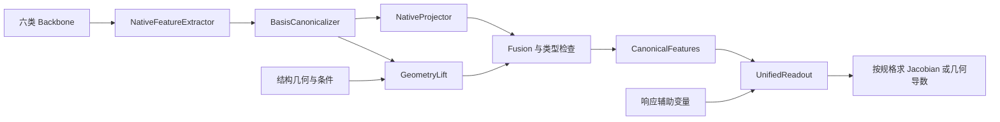

# 六类 GNN 的统一特征适配层

状态：设计稿，尚未实现或实测。范围沿用[工具箱主计划](gnn_task_toolkit.md)：MACE、NequIP、Equiformer、ALIGNN、CGCNN、MEGNet；响应性质默认求导，不增加晶体空间群约束。

## 1. 目标与边界

设计 UnifiedFeatureAdapter，将各 backbone 读出前的节点特征及结构几何转换为固定规格的 CanonicalFeatures。同一实验内，六类模型使用相同的输出 profile，后续 UnifiedReadout 不读取模型名称、原始维数或私有图对象。

上述是显式选择 common_equivariant 时的“六类模型接相同等变输入规格”模式。本文 §6 另提供 invariant_alignn 轻量模式：统一公共 API，但允许标量/等变两类特征规格与读出 backend。它不要求不变模型都生成 568 维等变表示；两条路线分别声明，不自动切换，也不将完整模式当作全框架默认。整体已定设计与待冻结规格见[主计划 §0](gnn_task_toolkit.md#0-当前设计结论与实施边界)。

统一的是输入规格与读出代码/结构；各 backbone 的投影器需要训练，同一读出结构在不同实验中通常也有独立参数。若要求跨 backbone 共享权重并复用同一份训练好的读出，应联合训练或对齐适配层，不能从相同维数推断语义已经一致。

本设计不追求无损转换：固定通道数可能压缩原特征，几何提升增加了新的可学习计算。它不能恢复 backbone 已丢失且几何/输入条件也不包含的信息，不承诺同等精度或任意目标的表达完备性。



## 2. 输入与统一输出

### 2.1 输入对象

- NativeFeatures：选取层的带梯度节点张量、各块的实际表示/基底/归一化、节点映射；可选图级全局状态，边特征可缺省。
- GeometryContext：positions、cell、batch/ptr、PBC、原子对应，以及带整数镜像偏移的邻居索引。图索引允许离散，位移/距离/角度必须从当前几何在线计算。
- Context：时间步、温度等标量条件及明确类型的其他条件；不能把向量/张量条件当普通标量通道拼接。

MEGNet 的 state 输入由 Context 映射，更新后的 state 可作为 graph_features；不存在该字段的模型不需要伪造 state。

### 2.2 CanonicalFeatures

| 字段 | 含义 |
| --- | --- |
| kind | invariant 或 equivariant，结合 profile 决定合法读出 backend |
| node_features | [N,D_profile] 的打包张量，同一 profile 的维数固定，不混合不同表示的空间分量 |
| spec | 共同的 group、irreps/布局、实基底、归一化、profile/version 与切片表 |
| batch / ptr / atom_map | 结构边界和原子对应，保留逐节点输出能力 |
| geometry | 当前坐标/晶胞计算图的引用，供力/应力等操作使用 |
| context | 条件和可选规范化图级特征，带明确类型 |

适配层不做结构 pooling。结构级/节点级、sum/mean、谱轴与输出单位由后续读出规格决定，避免把原子任务和总能量误用同一种聚合。

### 2.3 固定 profile

先给出覆盖通用二/三/四阶 polar 张量所需类型的 O(3) profile，通道数只是首版建议，尚未经资源/精度验证：

```text
response_full_rank4_v1:
  64x0e + 16x0o + 32x1o + 16x1e + 16x2e + 16x2o
  + 8x3o + 8x3e + 8x4e
```

该 profile 为 568 维，分块布局是 [N,C_(l,p),2l+1]，打包后为 [N,568]。它包含一般二阶 even、三阶 odd、四阶 even 张量的所需类型与足够的目标 multiplicity；“类型可用”不等于已证明完整表达能力。

通道数/profile 对所有对照模型保持一致。标量任务以后可采用只含 0e 的精简 profile；选择依据输出/响应规格，不由 backbone 私下改变。超过现有 rank/类型范围的目标要显式扩展 profile，不能静默截断或补零后宣称支持。

SO(3) 与 O(3) 必须区分：仅知 l 的通道不能自动赋予可信 parity。采用 O(3) profile 时，native 分支及几何权重输入都必须满足相应反演规则；仅 SO(3) 实现需另选匹配的实现/配置，或整组实验显式采用 SO(3) profile 并只声称相应保证。换基、MLP 或几何补充都不能自动修复不正确的 parity 声明。

## 3. 适配层的五个步骤

### 3.1 NativeFeatureExtractor：每个模型的薄适配器

| 模型 | 抽取位置与输出 |
| --- | --- |
| MACE | 指定交互层的节点特征；可拼接多个层，逐层声明实际 irreps |
| NequIP | 最后一个仍有目标非标量通道的卷积层，或声明的多层组合 |
| Equiformer | 标量输出投影前的注意力块节点表示；版本和取层写入 checkpoint |
| ALIGNN | crystal pooling 前的节点 x |
| CGCNN | 最后卷积后、crystal pooling 前的 atom_fea |
| MEGNet | 图网络块后的 node_feat；state_feat 作为可选图级输出 |

只返回结构级预测值的包装器不满足该接口，需接底层节点计算。模型特有的构图、初始元素特征和库对象在此处理。抽取默认不 detach，不经 NumPy；冻结 backbone 参数也不能切断任务所需输入梯度。

### 3.2 BasisCanonicalizer：确定性表示规范化

核对节点排列，按真实表示分块，把已知等价基底/分量顺序/归一化转换到公共约定。不变模型的 C 个标量登记为 Cx0e。拼接多层特征时拼接同类型的 multiplicity 轴，不把不同 l 当普通通道混合。

这一步是固定换基，不负责生成缺失阶数。没有明确转换关系的库特征应由模型插件补齐，不能猜测 reshape。规范化使用类型安全的缩放，不用会破坏向量/张量变换的逐分量独立标准化。

### 3.3 NativeProjector：保留已有等变信息

对每个 (l,p) 用可训练的通道投影 P_(l,p) 匹配公共 multiplicity，同一通道投影作用于该 irrep 的所有 m 分量。必要时使用类型合法的张量积读出；不强制将等变特征降成标量再重建。

ALIGNN/CGCNN/MEGNet 的该分支起初只有 0e。缺少某类型时，只能标记该分支缺省；是否支持公共 profile 由融合后的实际路径校验，不能靠填零伪造能力。

### 3.4 GeometryLift：从不变特征构造方向信息

先构造节点不变描述 s_i：使用 0e 通道和非标量通道的合法不变量，可加入归一化的图级标量状态。O(3) 模式下 0o 不能直接当作 even 标量门控。由当前几何计算 r_ij = r_j + image_ij * cell - r_i、d_ij 和方向球谐。

种子特征可以写为：

```text
g_i^(l,(-1)^l,a) = sum_j w_a(s_i,s_j,RBF(d_ij),context) cutoff(d_ij) Y_l(r_ij)
```

w 是不变标量权重；每个通道可有独立径向/化学权重。首版可取 seed_lmax=4，再通过有限轮数的类型合法张量积耦合到公共 profile。[球谐](https://docs.e3nn.org/en/stable/api/o3/o3_sh.html)与[张量积](https://docs.e3nn.org/en/stable/api/o3/o3_tp.html)的变换规则可作为实现依据。

单方向 Y_l 只提供自然 parity，不能覆盖一般张量所有类型。需允许不同通道/不同邻域矩的耦合，例如 [g_1o^a ⊗ g_1o^b]_1e 产生轴向类型，再与另一个 1o 耦合可产生 0o。不能把同一个向量与自身叉乘作为非零方向来源，也不能只依赖一个全对称外积。

建议首版 coupling_depth=2，以覆盖上述类型生成路径；实际通道、几何对称和特征退化仍会影响非零性与表达能力。符号可达性仅是静态门槛，验收还需通用非退化几何的数值检查；真实对称结构的合法零分量不能判作失败。

几何邻域由公共几何服务提供，不要求 backbone 暴露边隐特征；也不要求其消息传递改用这张图。adapter 的 cutoff、镜像/重复边规则、额外计算与参数预算单独记录。使用平滑 cutoff，并检查邻域变化及高阶导数；不建立旋转局部坐标架来硬对齐特征。

### 3.5 Fusion：合成完全相同的输出规格

对每个类型：

```text
z_i^(l,p) = alpha_i^(l,p)(s_i) P_native(h_i^(l,p))
            + beta_i^(l,p)(s_i) P_geometry(g_i^(l,p))
```

alpha/beta 为不变标量门控；投影权重在 m 分量间共享。只在合法 0e 标量块中使用普通偏置，不为非标量块加入固定方向偏置。输出按 profile 的唯一切片顺序打包。

common_equivariant 路线支持 native_only、geometry_only、hybrid 三种适配模式，本路线建议 hybrid：六类模型都可使用同一几何分支，等变模型额外保留 native 非标量通道。该建议不适用于 invariant_alignn。native_only 缺类型则报错，geometry_only 适合控制表示来源的消融；模式及参数量作为实验条件记录。

编译时检查目标类型存在合法路径、profile/库表示一致、每个节点有定义且样本无串联。几何空邻居允许合法零方向特征并按策略记录；不能承诺退化输入也提供完整方向基。运行时检查 shape、dtype/device 与有限值，不要求数值上所有块都非零。

## 4. 同一个读出器的接口

以下为设计伪代码，尚非可执行 API：

```python
native = backbone.encode(structures, context)
features = feature_adapter(native, geometry, context)
outputs = readout(features, task_spec, auxiliary_inputs)
```

UnifiedReadout 只依赖 CanonicalFeatures.spec 和目标/响应规格，不写 if model_name，也不处理私有图对象。不同任务仍按 scope、表示、类别/采样轴创建相应模块；“同一个读出器”指同一套可配置实现，不是一组固定输出维度覆盖所有目标。

响应默认路径：

1. 适配层计算 Z(H,geometry)，默认不引入响应辅助扰动 q。
2. 读出器依据 response_spec 生成 R(Z,q)，原子级或结构级聚合按规格执行。
3. 统一导数操作求 dR/dq，并保留 Jacobian 的参数反传图。
4. 对预测响应施加损失，更新 readout、feature_adapter 与允许训练的 backbone。

这样介电、压电、弹性仍共用响应读出工厂；辅助变量按声明类型参与耦合。q 在零点取值也不能先被常量化。辅助应变响应与真实几何应变是不同构造，不能不加声明就让两条路径同时生效。

力/应力则从共同的不变能量读出，对坐标/一致应变沿 backbone、adapter 与几何服务的完整计算图求导。响应不必来自同一力场能量，也不要求单独提供扰动态响应标签。用于生成的时间步必须传到声明的条件化位置，不能把统一特征接口误当作已完成去噪训练。

几何 lift 可能把冻结原始节点缓存与几何重新连接，但该连接不包含缓存节点特征本来对几何的依赖。用于原模型总能量/力等全过程导数时仍需在线运行 backbone；不能将部分梯度当作完整梯度。

## 5. 模块与实施验收

```text
backbones/<model>/      # 六类薄抽取器，各附 README
adapters/
  README.md             # 接口、类型和梯度契约
  profiles/             # 版本化公共规格，附 README
  canonicalize/         # 换基/布局/归一化，附 README
  projection/           # 原生表示通道投影，附 README
  geometry/             # 球谐/不同通道耦合，附 README
  fusion/               # 门控和公共打包，附 README
readouts/               # 只消费 CanonicalFeatures，附 README
```

公共几何计算服务与数据构图职责分开：前者从当前张量计算连续几何，后者提供拓扑/整数镜像及样本映射。checkpoint 保存 extractor 取层、FeatureSpec、profile、几何/融合配置、适配器与读出参数及数据/目标版本。

验收按实现单元推进，以下均是未来测试，不是本轮已通过结果：

- 抽取/规范化：六类模型节点对应、批次隔离、类型和基底变换、已知转换往返；不以 padding 后形状相同替代表示校验。
- 投影/几何/融合：旋转、适用时反演、平移、原子置换、PBC 镜像等价；缺路径报错、非退化几何的方向覆盖，以及只读出所需 profile 的预算。
- 梯度：参数、坐标/晶胞、辅助变量 Jacobian；有限差分与需要的高阶反向，检查冻结参数时输入梯度仍在。
- 读出隔离：共同等变路线验证同一 profile/等变读出；轻量路线验证标量规格与分量 backend。两者共享 API，不含按模型名分支，也不宣称独立训练权重已可互换。
- 资源/效果：分别记录 backbone、adapter、readout 参数/时间/显存；标量预测、响应监督和几何导数各选公开小数据验证，再扩展任务。

本轮仅做文档、示例与表示类型的符号检查，未安装或运行 e3nn、未实现 adapter，也未实测旋转、梯度或精度。

## 6. 可选简化：不变模型按 ALIGNN 路线

ALIGNN、CGCNN、MEGNet 可以共用轻量 ScalarAdapter：抽取 pooling 前节点标量，用逐节点 MLP/通道投影得到统一 [N,C]；保留 batch/ptr、几何与可选全局状态，不强制执行 GeometryLift。公共特征容器显式登记 kind=invariant、Cx0e，并选择 invariant_alignn profile。等变模型继续采用前述规范化/投影路线。

两类输出均传入 UnifiedReadout(features, task_spec, auxiliary_inputs)。由特征 kind 与任务规格选择 invariant_components 或 equivariant backend，分别复用通道投影/MLP与等变响应模块；不按模型名字写分支。同一 API、同一 loss/评测/导数操作可以共用，但不把这称作两类输入完全相同的等变网络或已训练权重可互换。

ALIGNN 参考边界：

- 标量、逐原子标量、分类、标量谱：按输出 scope 选择节点 MLP 或 pooling＋MLP。
- 力/应力：从不变总能量对几何求导，输入距离/角度/晶胞保留梯度；不需要先产生高阶隐藏特征。
- 张量：已核对的 ALIGNN tensor recipe 以固定长度分量作为标签，配置 output_features 且关闭 calculate_gradient，这是直接回归示例，不是 GMTNet 风格辅助变量求导。[固定快照示例](https://github.com/atomgptlab/alignn/tree/23f0146c4a61260fab5c5c9eb72a516491b76a70/alignn/examples/recipes/tensor)

轻量模式仍遵循用户已指定的响应默认 derivative：响应函数从标量特征和辅助变量构造，再交给公共 Jacobian 操作。可以采用不受旋转约束的分量响应，例如 R(H,q)=A(H)q；其 Jacobian 就是 A(H)，数学上等价于直接预测这些系数，求导包装本身不会增加旋转等变或热力学一致性。该响应可以训练，但必须标明固定数据坐标约定、无一般方向变换保证，不能冒充等变响应。

因此将 construction 与 transformation_guarantee 分开记录：前者仍为 derivative；后者可显式选择 fixed_frame_components 或经验证的 equivariant。沿用 ALIGNN 固定分量方案时，数据与标签必须保持统一坐标约定；不能仅旋转结构并假设预测分量会自动随之旋转。数据坐标标准化也不自动等于任意旋转下的严格等变。

若要求一般方向张量或生成坐标 score 满足相应变换规则，仍需显式加入几何方向/完整几何导数或回到前述统一等变 profile。不能仅对不变标量做 MLP reshape 就满足这些保证；生成按 ALIGNN 等方法构造合适的坐标输出后再接采样流程，不把固定张量分量回归当作完整生成器。

该模式是本轮新增的设计选择：geometry lift 不作为所有不变任务的前置条件，响应默认求导也不因选择 ALIGNN 风格而被静默替换。用户可按任务选择“统一 API＋轻量分量 backend”或“统一等变输入＋同一等变读出”；需在实验中记录模式、变换保证、参数/预算和数据坐标约定。尚未实现或评测。
