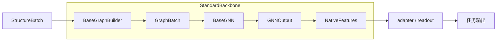

# UGNN 扩展接口与文件格式标准 v1

## 官方骨干初始化策略

`backbone.initialization` 对官方 provider 区分 `pretrained`（默认严格加载发布权重）与
`scratch`（使用原始架构构造器的全新状态）。`prediction.head_mode: reset` 仅决定任务头，
不能代替骨干初始化。配置和checkpoint保留初始化策略；旧官方配置省略时按pretrained解释，
严格续训不允许改变此策略。scratch与官方native头、骨干warm-start不兼容；只复用读出器也须另记来源，
不能把该整次运行称为完全从头训练。

四原模型入口已实现构造与严格状态布局检查，Slurm910/911原包构造/图/统计验收已通过，
四模型带隙各两版真实GPU诊断已完成；其他任务及全量48/144矩阵仍须分别验收。
MACE/NequIP需先通过显式CLI准备完整训练分区的原生邻居统计，
重置源模型的能量偏移/缩放；NequIP保留原包实际irreps布局与作者架构。自动训练解析另行接入。
原始artifact可作为架构蓝图，但scratch不得复制学到的参数或BN/目标拟合统计。

本文件是 GNN、分子/晶体图、config、dataset 和 checkpoint 的统一规范。
使用命令见 [usage](plan/usage.md)，最小可执行扩展见
[custom_knn_gcn](../examples/custom_knn_gcn/README.md)。规范与实现对应，未支持的能力不通过字段名暗示。

## 1. 版本与职责

| 对象 | 当前版本 | 版本字段 / 实现 |
| --- | --- | --- |
| 配置 | 1 | `schema_version: 1`；`engine/configuration.py` |
| 数据集 | 1 | JSON 包装对象 `schema_version: 1`；`data/formats.py` |
| 图 | 1 | `GraphRecord` / `GraphBatch`，JSON graph 可标 `schema_version: 1` |
| GNN 协议 | 1 | `BaseGNN`、`GNNOutput`、`StandardBackbone` |
| checkpoint 容器 | 2 | `format_version: 2`，独立于上述接口版本 |
| 续训状态 | 1 | 可选 `training_state.version: 1` |

未知显式版本报错。未带版本的旧 JSON/JARVIS/ASE 数据、旧配置、format 1/2 权重继续兼容读取，
不将旧记录改写成新格式。新 checkpoint 的 `contract_versions` 记录生产者支持的四种接口版本，
不表示训练源文件已被改写。

模型/图构建器不得将 targets 当输入特征；标签仅供训练损失使用。

职责：dataset 提供原子、几何、标签和可选原始图；graph builder 提供拓扑与可选特征；GNN 只提供
读出前的节点表示；统一 adapter/readout 根据性质规格生成预测。原子顺序和样本映射在整个链中保持。



## 2. 几何输入：Structure / StructureBatch

`universal_gnn.contracts.Structure` 表示一个结构，`StructureBatch.from_structures` 负责拼批。
新训练默认 float32；独立数据读取接口仍默认 float64，旧checkpoint未记录dtype时保留float64解释。
设备和精度通过 `batch.to(device, dtype)` 一致迁移。

| 字段 | Shape / 类型 | 含义 |
| --- | --- | --- |
| `numbers` | int64 `[N]` | 正原子序数；实际允许元素由所选模型的原始元素表决定 |
| `positions` | float `[N,3]` | 笛卡尔坐标，angstrom |
| `cell` | float `[3,3]`；拼批为 `[B,3,3]` | 非奇异，晶格矢量按行存储，`r = f @ cell` |
| `pbc` | bool `[3]`；拼批为 `[B,3]` | 各晶格轴周期性 |
| `identifier` / `identifiers` | string / tuple | 样本标识 |
| `targets` | 字典 / 按样本的 tuple | 原始或绑定后的标签，不放入可训练节点表示 |
| `metadata` | 字典 / tuple | 来源、单位等说明 |
| `graph` / `graphs` | 可选 GraphRecord / tuple | 导入图，可不提供 |
| `batch` | int64 `[N_total]` | 每个原子属于哪个样本，仅拼批对象有 |
| `ptr` | int64 `[B+1]` | 原子前缀和，从 0 到 N_total |

非周期分子用三个 false。标准 JSON 可省略其 cell：读取器生成每轴跨度加12 angstrom的包围盒，
不移动原坐标，并记录其为计算用非周期包围盒。周期结构必须显式提供 cell。
分子包围盒的应力不是物理体材料应力，不能据此伪造分子 stress 标签。

## 3. 图规范与导入

### GraphRecord：单结构局部图

```python
GraphRecord(edge_index, cell_shifts=None, node_features=None, edge_features=None)
```

| 字段 | Shape / 类型 | 规则 |
| --- | --- | --- |
| `edge_index` | int64 `[2,E]` | 第一行 src，第二行 dst；消息从 src 到 dst；局部索引在 `[0,N)` |
| `cell_shifts` | int64 `[E,3]` | src 的周期镜像偏移；省略视为零；非周期轴必须为零 |
| `node_features` | 可选 float `[N,F_n]` | 按原子顺序的标量输入属性 |
| `edge_features` | 可选 float `[E,F_e]` | 与边顺序逐行对应的标量属性，例如键类型编码 |

所有特征须有限。没有边特征是正常输入；不得依赖其必然存在。需要张量输入的自定义模型应基于
几何构造相应表示，或明确在自定义接口中处理类型，不能将任意向量分量当不变标量使用。

### GraphBatch：构图器和 GNN 之间的输入

`GraphBatch(geometry, edge_index, cell_shifts, node_features=None, edge_features=None, metadata={})`。
`geometry` 必须保留传入的同一个 StructureBatch；拼批索引为全局原子索引，无跨样本边。
整数索引/shift 和浮点特征与几何同设备，浮点特征与几何同 dtype。

派生属性：`src`、`dst`、`edge_batch`、`vectors`、`distances`。位移定义为：

```python
vectors = positions[src] + cell_shifts @ cell[edge_batch] - positions[dst]
```

已有图对象可显式转换，例如 `GraphRecord(edge_index=data.edge_index, node_features=data.x,
edge_features=getattr(data, "edge_attr", None))`；JSON使用本规范字段名，拼错的图属性不会被静默忽略。

`vectors` 每次从活的 positions/cell 计算，保留 autograd；图中不缓存脱离计算图的距离代替它。
图构建器允许离散选择拓扑，GNN 的几何特征须在该拓扑上连续计算。KNN换邻、等距截断等边界
不能承诺全局可微；测试力/二阶导应避开拓扑变化点。这与把坐标 detach 后计算消息不同。

### BaseGraphBuilder

```python
from universal_gnn.contracts import BaseGraphBuilder, GraphBatch

class MyGraph(BaseGraphBuilder):
    def forward(self, batch) -> GraphBatch:
        # 计算局部/全局拓扑，保留 batch 及原子顺序
        return GraphBatch(batch, edge_index, cell_shifts)
```

支持的 `graph.name`：

- `knn`：非周期、逐分子 KNN，默认 k=3，对称并去重；每个原子的候选数取 min(k,N-1)。
  孤立点无边。等距邻居按原子序号稳定截断，重排等距原子时不能据此承诺严格置换等变。
- `radius`：cutoff 内完整邻居图，按每个结构/方向的 `pbc` 处理周期镜像，支持晶体、分子及混合batch；当前请显式设置 `cutoff`。
- `stored`：导入每个 Structure.graph，拼批时给局部索引加 ptr 偏移，保留特征对应关系。
- `plugin:/folder`：加载该目录 `plugin.py:build_graph_builder(**options)`，必须返回 BaseGraphBuilder。

内置 KNN/radius 可传递节点属性，重建边时拒绝沿用未重排的静态 edge_features；这类输入须选 stored
或由自定义构图器重新计算/映射边属性。不得静默错配。

### 已确认、待实施的非官方构图默认值

非官方构图的统一默认策略为 **radius graph，cutoff=6.0 Å**：

```yaml
graph:
  name: radius
  cutoff: 6.0
```

适用于框架通用构图、自定义模型以及新增CGCNN/ALIGNN分子输入profile。
晶体使用输入声明的逐轴PBC，只在周期轴枚举镜像；分子须声明 `pbc: [false, false, false]`，所有image为零。
小晶胞保留截断内所有有效镜像，包括非零image的自身镜像；排除零image自身边，不仅取minimum image。
默认不加KNN/邻居数上限，也不因邻居不足自动扩大cutoff；空邻居、变长邻居由模型输入适配器明确处理。
距离、位移及需要的角度从live坐标/晶胞计算，拓扑选择与连续几何求导分开。

官方原始预处理默认仍按checkpoint的原图规则及截断执行；更换为此通用构图须显式标记新输入profile。
6Å是构图截断，不自动改变官方模型的RBF中心、特征维数或已固定的内部径向参数；有模型内部额外截断时须记录有效范围。

本段记录新默认约定，尚未改变代码的省略配置行为：当前标准包装器省略graph仍使用KNN，RadiusGraphBuilder类自身默认cutoff仍为4Å。
上述显式6Å配置已适用于标准包装GNN；官方CGCNN/ALIGNN的新增分子profile仍待实现。
实施新默认时须保留旧checkpoint的构图重建语义，不得静默把旧KNN/4Å模型改为6Å模型。显式KNN插件测试示例继续保留。

## 4. 标准 GNN 与统一包装类

```python
from universal_gnn.contracts import BaseGNN, GNNOutput

class MyGNN(BaseGNN):
    def __init__(self, width=16, context_dim=0):
        super().__init__(irreps=f"{width}x0e", kind="invariant", context_dim=context_dim)
        # 注册原模型 / 可训练模块，如 self.encoder = ExistingGCN(...)

    def forward(self, graph, context=None) -> GNNOutput:
        # 原模型可在这里适配自己的参数签名：
        # nodes = self.encoder(x, graph.edge_index, ...)
        return GNNOutput(nodes)
```

`BaseGNN.forward` 输入 GraphBatch；可选 context 为 `[B,context_dim]` 的不变条件，必须在
声明 context_dim>0 时处理。生成等条件任务会传入它；不能静默忽略声明支持的条件。

`GNNOutput` 字段：

| 字段 | Shape / 类型 | 规则 |
| --- | --- | --- |
| `nodes` | float `[N_total,D]` | 必需，读出前节点特征；D 等于声明 irreps 的维数 |
| `graph_features` | 可选 float `[B,F]` | 图状态；共用读出不会自动拼接它到 nodes |
| `metadata` | dict | 非训练说明 |

`kind="invariant"` 只允许 `0e` 通道；等变模型声明准确的 O(3) irreps、奇偶性和通道排列。
所有节点必须一一对应原子，不在 backbone 中池化或删除节点。类型/形状检查不能证明任意用户网络
真的满足声明的旋转规律，用户须验证其数学性质。输出须与几何同设备/精度并有限。

`StandardBackbone(gnn, graph_builder, cutoff=4.0)` 是统一包装类：

1. 构图并检查索引、映射、特征；
2. 调用 GNN，检查 GNNOutput；
3. 包成现有 `NativeFeatures`，提供 `.encode(batch, context)`、`.irreps`、`.kind`、`.cutoff`；
4. `prediction.version: 1` 时原生节点直连已注册读出，或显式使用可选 adapter；省略 prediction 时保留原有 scalar/equivariant adapter 和通用读出器。

`backbone.cutoff` 是包装层几何提升/方向读出的半径，不等于 KNN 的 k。
`graph.cutoff` 才是 radius 构图的截断；新式 build_gnn 工厂接收除包装层 cutoff 外的 backbone 选项。

目录插件示例：

```python
# plugin.py（支持 .model / .graph 相对导入）
from .model import MyGNN
from .graph import MyGraph

def build_gnn(**options):
    return MyGNN(**options)

def build_graph_builder(**options):
    return MyGraph(**options)
```

两个工厂可在同一目录，也可分别放置。现有 `build_backbone` 插件作为兼容接口保留；要独立选择图，
应实现 build_gnn。原有六种原生主干仍使用自身所需图结构，显式给它们配置外部 graph 会报错，
不会声称已接入实际上被忽略的图。

## 5. Config v1：YAML / JSON

配置必须是 mapping，新文件明确声明版本；JSON 与 YAML 字段等价。

```yaml
schema_version: 1
seed: 123
structures: 10
device: cpu
learning_rate: 0.001
epochs: 30
checkpoint_every: 1
backbone:
  name: plugin:examples/custom_knn_gcn
  width: 16
  layers: 2
  cutoff: 4.0
graph:
  name: plugin:examples/custom_knn_gcn
  k: 2
dataset:
  path: data/acceptance/molecules-g2-10.json
task:
  kind: supervised
  property: ionization_energy
  spec:
    scope: graph
    shape: [1]
    unit: eV
```

forcefield任务可设置 `task.supervised_outputs: [forces]`，或选择total_energy/forces/stress的
任意非空无重复子集。省略保持E/F/S默认值。仅选中的绑定、标签、归一化尺度和损失参与训练；
loss_weights用于选中项加权。模型的预测输出仍为E/F/S。完整续训校验监督集合（顺序不影响语义）；
仅力监督不能校准绝对能量及元素参考能。配置示例见configs/mace_force_only.yaml。

`backbone.name` 也可为 gcn，或现有六个内置模型。graph 仅用于标准包装模型。
`dataset.path` 可为标准文件或旧格式，也可为 `plugin:/folder`（工厂 build_dataset，参数在
`dataset.options`）；可选 bindings 显式声明原字段、单位与转换。
`task.kind` 为 supervised / forcefield / generation，性质规格负责输出shape/单位/构造，不由名字猜。

CLI > 配置文件 > resume配置 > 默认值。`--graph` 覆盖图名称，换名称时重置旧构图器专属选项；
额外参数写到对应 graph mapping。所有相对路径以当前工作目录为基准；示例在仓库根目录执行。

完整续训要求相同模型/图配方、选中结构、图/特征、标签/绑定与 seed；epochs 是累计目标轮数，
允许显式调整学习率。推理允许换数据和设备，模型/图/性质构造必须与checkpoint兼容。
当前训练器支持mini-batch；省略structures或设null/all时使用全部数据，显式整数才限制样本数。
子集选择与精度配置见本文件运行时规范；训练/测试文件由用户明确指定，不自动作正式数据划分。

## 6. Dataset v1：JSON / JSONL

规范 JSON 包装为 `{schema_version: 1, metadata: {...}, structures: [...]}`。
规范 JSONL 每行是下面的单记录，并带 `schema_version: 1`；旧无版本JSONL继续兼容。

预测用格式示例（没有人为构造监督标签）：

```json
{
  "schema_version": 1,
  "metadata": {"coordinate_unit": "angstrom"},
  "structures": [
    {
      "id": "example-n2",
      "numbers": [7, 7],
      "positions": [[0.0, 0.0, -0.565], [0.0, 0.0, 0.565]],
      "pbc": [false, false, false],
      "targets": {},
      "graph": {
        "schema_version": 1,
        "edge_index": [[0, 1], [1, 0]],
        "cell_shifts": [[0, 0, 0], [0, 0, 0]]
      },
      "metadata": {}
    }
  ]
}
```

显式v1记录只使用上述标准字段，几何不能再混用 atoms/coords/cartesian 等旧别名；缺少 targets
表示空标签字典，而不是把几何字段当作标签。额外说明放 metadata，旧格式仍通过无版本兼容入口读取。

每条记录 id 必须为非空字符串且在文件内唯一；numbers 为整数、positions 为有限 N×3，pbc 三个bool。
训练 targets 存 task 指定名称或 bindings 指向的数值，允许节点/谱/张量的嵌套数值数组；标准格式
要求有限值，未标注数据用于推理/生成。任务头检查实际目标shape，不假设所有任务标签相同。

可选 graph 的 node_features、edge_features 使用二维数值列表。零条边写 `edge_index: [[],[]]`；
cell_shifts 可省略或为空列表。空 edge_features 若要保留列数，附 `edge_features_width: F`，
序列化器自动处理。元信息/单位说明放 metadata；不得将缓存的边距离当作实时几何。

Python 导入/导出：`load_structures(path)`、`save_structures(path, structures, metadata=...)`。
数据插件返回 Structure 序列，可给每个对象附 GraphRecord，随后同样由 stored 构图器批处理。
KNN图是几何近邻图，不等于化学键识别，不保证价态/分子有效性。

## 7. Checkpoint v2

使用 `torch.save` 的字典，加载使用 `torch.load(..., weights_only=True)`；不保存模型对象或函数。

| 键 | 内容 |
| --- | --- |
| `format_version` | 2；旧无标记文件按 format 1 的几何基底约定加载 |
| `config` | 重建模型/图/任务的完整解析后配置 |
| `state_dict` | 张量权重，包含 GNN、adapter、readout；构图器若有可训练参数也在其中 |
| `versions` | 已知运行依赖版本 |
| `contract_versions` | `{config:1,dataset:1,graph:1,gnn:1}` |
| `extensions` | 自定义 GNN/graph 的工厂、源目录说明、全部 .py 相对文件和SHA256；没有插件时为空 |
| `scales` | 有监督任务归一化尺度；生成任务无此项 |
| `training_state` | 可选完整续训状态，见下 |

`training_state` 包含 version=1、completed_epochs、optimizer_state_dict、Torch CPU RNG、实际使用
CUDA设备的RNG、data_fingerprint、initial_loss、history与梯度记录。周期性checkpoint原子替换，
日志不进入权重。只恢复权重的旧文件明确记为 weights_only 暖启动。

数据指纹包括选中样本的ID、原子、几何、PBC、标签以及导入图/输入特征；不包含路径元信息。
插件指纹只哈希源码相对路径和字节，不包含绝对目录，可随同项目迁移；运行时从源码加载，避免
陈旧pyc与记录的源码指纹不一致。恢复时若插件源码变化，即使权重shape相同也会报错。

源码由 config 指定的 plugin 工厂重建，不从checkpoint执行pickle代码。分发自定义模型时必须
同时提供实现目录和兼容配置/依赖；仅有state_dict不足以恢复自定义架构。推荐保留仓库相对路径布局。

## 8. 最小验证与能力边界

```bash
# 在已配置环境、仓库根目录下；Guqq2须通过Slurm提交
ugnn --mode train --model plugin:examples/custom_knn_gcn \
  --config configs/custom_knn_gcn.yaml \
  --logging logs/custom-gcn --save checkpoints/custom-gcn.pt

ugnn --mode infer --resume checkpoints/custom-gcn.pt \
  --dataset data/acceptance/molecules-g2-10.json \
  --logging logs/custom-gcn-infer --results results/custom-gcn.json
```

`prepare_molecular_data.py` 从ASE G2-1原条目读取十个真实非周期分子及实验电离能，不计算新DFT。
`validate_extensions.slurm` 检查自定义KNN+GCN训练/续训/推理，另用导入的相同局部图独立训练，
对照连续训练、恢复训练和导入图的模型参数/预测一致性。数据记录源模块版本、文件SHA、ID、单位。

默认GCN使用距离权重，梯度经过节点特征、距离、坐标。没有边属性也可训练。
周期力场、应变和晶体生成须使用支持周期镜像的 radius / graph 插件；分子KNN不会被隐式当成周期图。
响应读出仍按既有求导规则，不能仅凭本接口就宣称任意用户算子支持高阶反向或严格等变。
小数据执行验证不代表泛化精度、化学合理性或完整论文复现。

## 9. 已取得的执行证据

最终实现源码 `a07ab00`，Slurm738用十个原始G2分子验证：

- 目录导入 `MolecularKNN` 和 `MolecularGCN`，经 StandardBackbone 接入统一性质读出；
- 训练15轮、完整恢复至30轮，与连续30轮参数逐项完全一致；
- JSON导入预计算局部图，独立训练与动态KNN参数/预测完全一致；
- 重载checkpoint后对十个分子推理，协议版本和源码指纹正确。

两环境Slurm739/740各52项检查通过。初轮735/736/737证据保留，不冒充最终源码。
本地 [实际报告与日志](../results/custom-extensions-738/evidence.json) 共217277 bytes，SHA256：
`b8cc046cf498e9e992bf7a4e295ccded33c54bd82c91f2aa6ce7be1b417d81ea`。
两个标准数据文件位于 `data/acceptance/molecules-g2-10.json` 和
`data/acceptance/molecules-g2-10-graphs.json`；checkpoint在服务器 `runs/custom-extensions-738`。
数据、权重和日志均不进入Git。结果仅证明执行/兼容，不是十样本的泛化精度结论。

## Runtime data selection, batching and precision

Top-level config: `structures` is a positive integer or null/`all` (default all), `batch_size`
positive integer (default 32), `max_atoms` optional positive integer, `shuffle` boolean (default true
for training), `dtype` one of float32 (new training default) or float64. `dataset.selection` is
first or random; `dataset.selection_seed` controls an explicit subset independently of epoch
shuffling. Each standard JSONL line is one complete dataset-v1 structure record; the envelope
form remains JSON only. Large inputs should use JSONL indexed reading.

Checkpoint format 2 training_state v1 may additionally contain `batching`, recording batch size,
atom budget, shuffle, dtype and subset policy. Complete continuation checks these settings in
addition to data fingerprint, seed and model/task compatibility. Checkpoints lacking dtype retain
legacy float64 interpretation. JSONL inference is an output stream: one `metadata` record, one
`prediction` or `generation` record per structure, then `completed` with structure_count. A node
prediction includes that structure's atoms only; a graph prediction preserves its leading batch
axis of length one. Units and task definition remain in the metadata config.

## Official model configuration and checkpoint artifacts

The canonical names alignn/cgcnn/megnet/mace/nequip/equiformer default to
`backbone.implementation: official`. Their graph preprocessing and architecture come from the
published artifact. `width`, `layers`, `cutoff` and `radial` are variant-only controls and are
rejected for original official models. A top-level custom graph is also rejected for these models.
Use an explicit `implementation: legacy` for old variants; old checkpoints lacking an official
artifact are restored as legacy even though the default for new construction has changed.

`backbone.checkpoint` initializes a provider from its original published serialization; CGCNN
also requires its original `atom_init`. Without an explicit path, the checksum-verified profile
in backbones/official/profiles.py is used. Weights must be prepared before submitting training.
Changing `--model` clears another official model's checkpoint and architecture-specific options.

## Prediction 组件协议 v1

`prediction.version: 1` 是显式可选的新组装协议；`schema_version: 1`、数据协议v1、checkpoint
format1/2 和 `training_state.version: 1` 保持不变。无 prediction 的配置与旧checkpoint继续按历史
32维适配、route、adapter/basis_version、state_dict 键重建，不自动迁移。

```yaml
prediction:
  version: 1
  readout: {name: graph_mlp, pooling: mean, hidden_features: [128, 64], activation: silu}
optimization: {train_backbone: false, train_readout: true}
```

### 输入规格与维度

`contracts.FeatureSpec` 的版本为1，字段为 `feature_dim`、`irreps`、`kind`、`basis`、
`transformation`、`gradients`，及审计字段 `source`、`dimension_assertion`。
优先读取模型 feature_spec（对象、字典或无参方法），再读取 irreps、模型 feature_dim；
config `backbone.feature_dim` 只用于回退或一致性断言，不传入主干构造器修改隐藏层。
全部有效维度声明须相同且为正整数。特征没有公开维度时在读出组装阶段拒绝，不创建 lazy 参数。

偶标量不变模型可只声明 `kind: invariant` 和 feature_dim，规范生成 `Fx0e` 与 scalar/invariant 语义。
非标量需准确 irreps、基底及 O3/SO3 变换声明；不能只依据宽度处理成标量。
当前内置等变转换要求 `basis: e3nn/component`；其他基底需自定义兼容读出或转换。
`gradients: {positions: bool, strain: bool, mixed: bool}` 缺项默认 false，表示未经能力声明，
不是由维度推断出的数学保证。新式力场要求三项均 true。

自定义标准类允许 `BaseGNN(irreps=None, feature_dim=F, kind="invariant", ...)`；
basis、transformation、gradient_capabilities 可通过基类参数声明。
旧接口提供 irreps 的用法保持。`StandardBackbone` 将声明传给新式组装。
每次 forward 在读出前验证 `[N,F]`、输入几何引用、batch/ptr、dtype/device、有限性和声明的表示语义。
可选 graph_features 保留，但内置读出明确不消费；自定义读出通过 ReadoutRequirement 声明是否使用。

### 读出与处理

| readout.name | 输入与运算顺序 | 附加字段 |
| --- | --- | --- |
| linear | 原生偶标量F；图池化后 Linear(F,D)，节点任务直接 Linear | bias，默认true |
| graph_mlp | 原生偶标量F；先图池化再MLP，仅graph scope | hidden_features正整数列表，activation=silu，bias=true |
| node_mlp | 原生偶标量F；先节点MLP再池化 | 同上 |
| response | 辅助变量求导；处理后的表示进入现有ResponseReadout | feature_processing |

D及输出形状来自 `PropertySpec`；读出不能重复声明另一套输出宽度。
`pooling` 默认来自性质 reduction，并必须与其相同：图任务 sum/mean，节点 none；response图任务仅mean。
新式力场限定 node_mlp+sum，将逐原子标量能量求和，再对位置/应变求力/应力。
`task.supervised_outputs` 仍控制E/F/S标签、scale和loss；force-only无需E/S标签。

`readout.feature_processing` 默认 `{name: none, version: 1}`，可选：

- `scalar_invariants`：标量与非标量范数等不变量，宽度从输入irreps确定，无隐式32维压缩。
- `equivariant`：须明确 `profile: small_response`、`basis_version: 1|2`；cutoff显式指定或取backbone.cutoff。
  内部复用已有几何/等变表示处理，归属readout参数组，输出规格单独记录。

response若无等变处理，偶标量输入预测固定坐标分量；采用等变处理时记录O3或SO3 Cartesian保证。
非标量输入不能隐式当固定标量。主干kind不再自动选择张量路线。
response保持辅助变量求导，不自动建立不同物理性质共享势能的关系，不施加空间群掩码。

`prediction.adapter` 也接受上述三种处理，只有显式非none才实例化独立组件；内部与独立处理不能重复同一种转换。
每段处理及 prediction 均检查未知字段和显式版本。generation拒绝prediction/optimization。
自定义读出注册方法见 [readouts](../src/universal_gnn/readouts/README.md)。

### 优化、重建与审计

`optimization.train_backbone/train_readout` 默认true；仅实际存在独立adapter时允许train_adapter，默认true。
无prediction的历史路径也允许单独配置optimization，历史adapter为实际组件。
组件参数所有权不得重叠；优化器仅包含允许训练参数。冻结组件保持eval，参数和持久buffer不得改变。
框架不因冻结使用no_grad或detach，保留输入导数及穿过冻结模块的梯度。全部冻结只允许推理。

可选 `optimization.backbone_eval: true` 将主干置eval但保留train_backbone控制的参数梯度，
用于固定BN统计/关闭随机层。absent/false保留历史策略的规范化表示；该字段须为bool且true属于续训策略。
新式官方CGCNN/Equiformer力场训练主干参数时要求显式true，冻结主干则无需额外设置。

新模型保存可选 `components` 字典：`version: 1`、architecture、policy、optimizer_groups。
architecture包含规格、读出配置/实现、pooling位置、组件类型拓扑和state键/shape；
optimizer_groups包含组件名称和有序参数名。原 `official_backbone` artifact/hash、extensions源码检查保持。
该可选扩展不改变旧容器版本；未知components版本拒绝。旧文件不补写新组件或新state键。
完整resume检查架构、冻结策略、参数分组，同时保留原数据/精度/采样/RNG/优化器兼容规则。
仅FeatureSpec.gradients由false提升至已验证的true时允许元数据兼容更新并记录路径；
该例外不允许能力降级、shape/irreps/基底/实现/层或策略变化，也不更改任何张量state。
推理允许关闭参数梯度，但不改变架构，并保留输出所需输入导数。

换头或训练策略使用显式 `--warm-start FILE --warm-start-components backbone`；可选择adapter/readout，
须逐组件通过状态键/shape/实现与语义检查；原官方artifact也须兼容。目标使用完整独立配置，重建优化器。
不允许全模型strict=False吞掉差异。旧32维→新路径迁移也使用此入口，只初始化兼容backbone。
report.initialization保存源checkpoint SHA、加载键、忽略和新初始化组件及优化器重建标记。

`config.resolved.json` 保存归一化prediction/optimization、原生F及来源、输入/输出规格、处理方式、
pooling位置和有效运行默认值。report.components列出各组件总/允许训练/冻结参数、实际模式，
内部处理不重复计入adapter。已知原任务头未使用参数单列；task_parameter_upper_bound与
effective_trainable_upper_bound为排除已知未使用参数后的上界，非精确有效容量测量。
报告中的训练损失与小规模执行验收不代表独立测试集性能。

完整配置和命令见 [组件使用说明](prediction_components.md)。
The new task head is randomly initialized; the original pretrained trunk is fine-tuned by default.

Checkpoint format2 can include `official_backbone` with version1, provider, source, files (original
artifact bytes), sha256 (per-file), and implementation signature. The original artifact rebuilds
the architecture; the main state_dict then restores fine-tuned parameters/buffers and the new
head strictly. Original weight paths need not exist on reload, but compatible official packages
and source code remain required. These published pickle-based artifacts must be trusted; the
custom plugin protocol's state_dict-only behavior does not make upstream pickle formats safe.
Source/backend signature mismatches are errors, even when tensor dimensions happen to agree.

## 官方预测头选择

`prediction.head_mode` 为 `native` 或 `reset`，省略默认 `reset`。
`native` 保留官方头、权重、池化、归一化与原任务，禁止额外 `readout/adapter`；
`reset` 按 `prediction.readout` 新建随机初始化的 UGNN 头，保留 backbone 权重。
`optimization.train_readout` 控制头是否训练，与头的选择独立。

NativeTaskContract v1 规定 property、scope、shape、kind、unit、reduction、head_paths、
原池化/归一化、artifact SHA256 和是否为瞬时势能。任务规格须完整匹配；未知 artifact
不得按 shape 猜任务。原模块路径和 checkpoint 状态键不变，组件视图分别管理原主干和头，
共享参数导致边界不明确时报错。完整续训不得切换 head_mode；显式主干 warm-start
跨模式只迁移 body，保留目标头，重建优化器。旧 reset 签名与历史 checkpoint 保持兼容。

## 固定数据分区与独立评测

可选的 `dataset.split_manifest` 指向split manifest v1；同时显式设置 `dataset.partition`
为 `train`、`validation` 或 `test`。目前要求标准索引JSONL来源。Manifest包含完整来源文件
SHA256、源顺序ID/组、三分区索引与实际计数；必须无重复ID、无跨区组泄漏、完整且仅覆盖一次。
同一比较中的骨干、初始化和训练seed复用同一manifest；分区seed独立于训练seed。
`structures` 的显式子集与 `dataset.selection` 在所选分区内生效，不改变其他分区。

监督/力场训练要求 `partition: train`，统计量只从实际训练记录拟合；每epoch完整验证集loss
选择真实最小值的best权重。`evaluation.patience` 为正整数或null，`min_delta` 为非负有限数；
二者只控制早停，min_delta不阻止保存更小的真实验证loss。完成后以best评测完整测试集；
训练loss与 `report.heldout` 分开。新增流程仍待Slurm数值验收，生成的独立评测尚未接入此路径。

Last checkpoint保持format2和training_state v1，另存 `training_state.evaluation`，包含验证历史、
manifest摘要、best路径/文件SHA256和早停状态。Best为无optimizer/training_state的format2权重文件。
完整resume必须保留并校验这对文件，验证历史可回放且与已完成epoch一致。Best候选文件只在last
原子提交后替换旧best；中断时按last记录的摘要从best/候选恢复。正常完成保留best+last，另预留
一次候选的临时空间；归档旧last时同时保留其对应best。

同源推理遵守显式分区；切换来源自动清除继承的分区/摘要，不能将训练源索引套到新数据上。
测试预测按结构写JSONL；不保留整批全量预测在内存。二分类AUROC以磁盘SQLite保存分数并精确处理
ties，单类别测试集返回null；张量同时报告逐元素误差与逐结构Frobenius误差，零张量保留在绝对
误差中，仅从相对误差分母排除并计数，不施加对称约束。详见
[分区规范](../src/universal_gnn/data/splits/README.md)和[评测模块](../src/universal_gnn/engine/evaluation/README.md)。

UGNN 统一包装原头的物理值：图标量 `[B,1]`，力场 total_energy `[B,1]`、forces `[N,3]`
（eV/angstrom）、stress `[B,3,3]`（拉伸正号 GPa）。原官方返回类型可通过 provider.native_forward
取得。详见 [原头协议、任务矩阵与配置](native_heads.md)。
